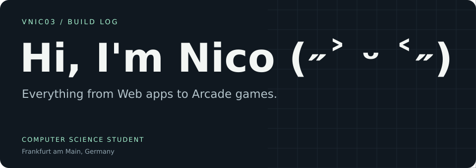
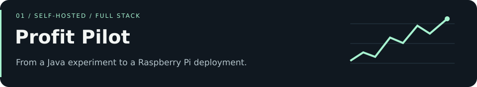
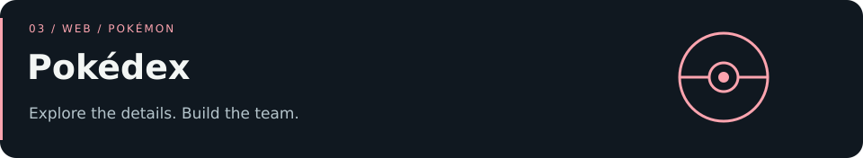
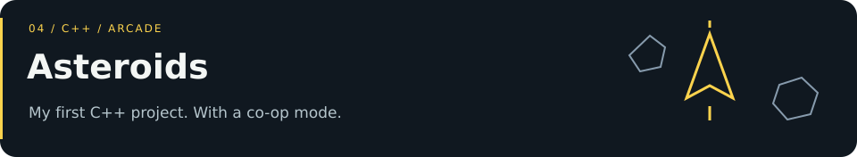

<!-- Generated by scripts/build.py. Edit profile.json, then rebuild. -->
<picture>
  
</picture>

  <a href="#selected-projects">Projects</a> ·
  <a href="#tools-in-context">Tools</a> ·
  <a href="https://www.linkedin.com/in/nicolas-petzel-8a18722b1/">LinkedIn</a>

I'm a computer science student in Frankfurt am Main, Germany. I build self-hosted web apps, terminal tools and games — from a stock research dashboard running on a Raspberry Pi to a Spotify player written in Rust.

## Selected projects

### 01 · [Profit Pilot](https://github.com/vnic03/Profit-Pilot)

A stock research dashboard with daily prices, technical indicators, company news and data exports. I run it on a Raspberry Pi 5, with Cloudflare Access and Tunnel handling access.

The work goes beyond charts: data imports, API budgets, deployment and recovery are part of the project too.

**Built with:** Java · Spring Boot · React · TypeScript · PostgreSQL

[Explore the code →](https://github.com/vnic03/Profit-Pilot) · [Hosted application](https://profit-pilot.trade) — invitation-only access.

### 02 · [Mini Player](https://github.com/vnic03/Mini-Player)

A compact Rust TUI for controlling Spotify playback and browsing playlists in the Kitty terminal. Includes keyboard controls and a PKCE login flow.

**Built with:** Rust · Spotify API · Kitty

[Explore the code →](https://github.com/vnic03/Mini-Player)

### 03 · [Pokédex](https://github.com/vnic03/Pokedex)

A Pokémon explorer with search, filters, evolutions, stats and cries, backed by locally stored PokéAPI data.

In development: a team builder with AI-assisted VGC insights.

**Built with:** React · JavaScript · Express · SQLite · Tailwind CSS

[Explore the code →](https://github.com/vnic03/Pokedex)

### 04 · [Asteroids](https://github.com/vnic03/Asteroids)

My take on the arcade classic, built with SFML: dodge asteroids, fight UFOs and chase persistent highscores. Play solo or together in co-op.

**Built with:** C++ · SFML · CMake

[Explore the code →](https://github.com/vnic03/Asteroids) · [Download & build instructions](https://github.com/vnic03/Asteroids#running-the-game)

## Tools in context

| Area | What I use | Where it shows up |
| :--- | :--- | :--- |
| Web applications | Java, Spring Boot, React, TypeScript | Profit Pilot |
| Data & APIs | PostgreSQL, SQLite, Express | Profit Pilot, Pokédex |
| Terminal interfaces | Rust, Spotify API | Mini Player |
| Games | C++, SFML, CMake | Asteroids |
| Self-hosting | Raspberry Pi, systemd, Cloudflare | Profit Pilot |

## Let's connect

Find me on [LinkedIn](https://www.linkedin.com/in/nicolas-petzel-8a18722b1/) or on Discord as **v_nic03**.
For questions about a project, open an issue in its repository.

---

  Built by Nico ·
  <a href="https://github.com/vnic03?tab=repositories">Browse all repositories ↗</a>

